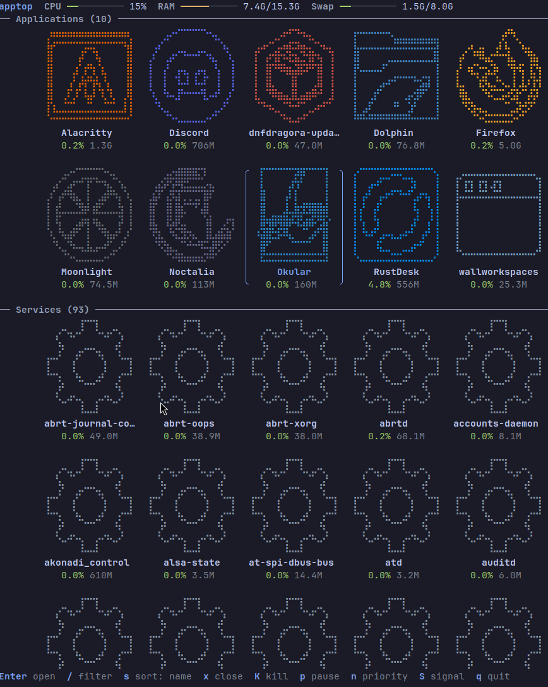
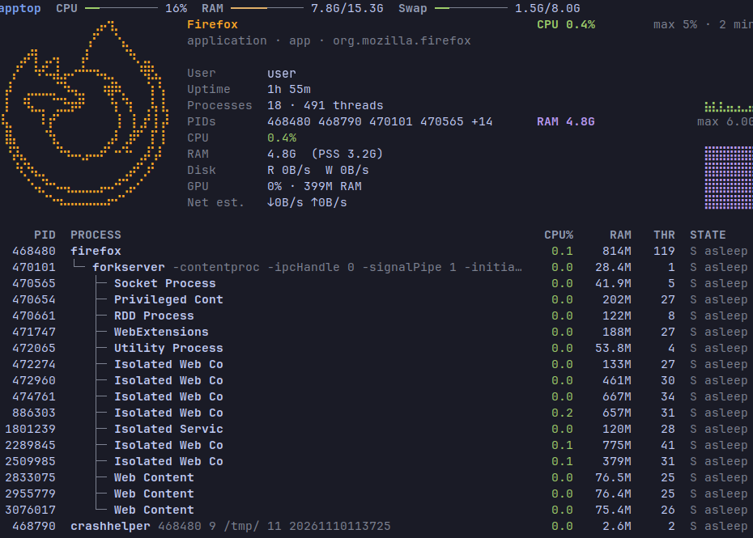
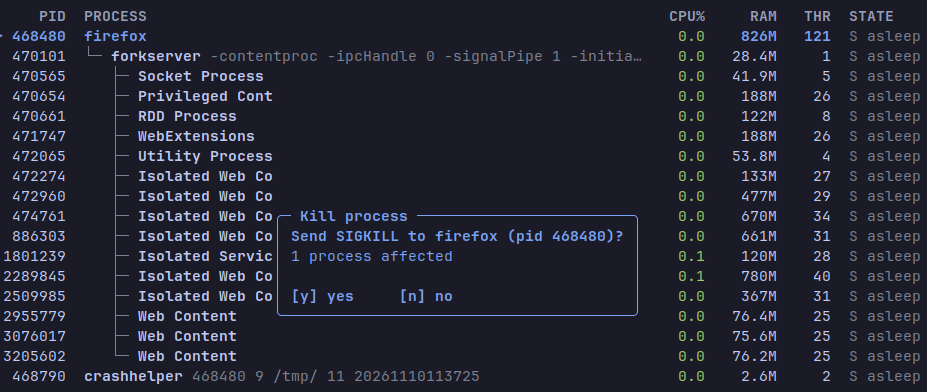

# apptop

[English](README.md) · **Español**

Monitor de recursos para terminal Linux, al estilo de btop pero centrado en
**aplicaciones** en lugar de procesos sueltos.

- La pantalla principal es una grilla con el icono de cada app y servicio en
  ejecución. Cada icono es el icono real de la app convertido a un contorno de
  líneas en braille (sin relleno ni fondo), pintado con su color dominante.
- Al abrir un icono se ve el detalle de esa app: todos sus procesos en árbol,
  CPU, RAM, disco, GPU y red, con gráficos de los últimos dos minutos.
- Desde ahí (o desde la grilla) se puede cerrar, matar, pausar, cambiar la
  prioridad o enviar cualquier señal, a la app entera o a un solo proceso.

No necesita root: lo que no se puede leer se muestra como `n/d`.

## Capturas

La grilla. Las apps con icono lo dibujan en su color; el resto usa una ventana
genérica y los servicios un engranaje:



Dentro de una app: sus datos, gráficos de CPU y RAM y su árbol de procesos:



Las mismas vistas en texto, sacadas de los tests de snapshot. Están en español
(`--lang es`).

Grilla (80×24). Las apps sin icono usan una ventana genérica y los servicios
un engranaje:

```text
apptop  CPU n/d  RAM n/d  Swap n/d                   ⟳ 1s · 3 apps · 2 servicios
── Aplicaciones (3) ────────────────────────────────────────────────────────────
    ╭ ⢀⣀⣀⣀⣀⣀⣀⣀⣀⣀⣀⣀⣀⡀ ╮  ⢀⣀⣀⣀⣀⣀⣀⣀⣀⣀⣀⣀⣀⡀    ⢀⣀⣀⣀⣀⣀⣀⣀⣀⣀⣀⣀⣀⡀
    │⢸⠁⡖⡆⢰⢲⢀⡖⡆     ⠈⡇│ ⢸⠁⡖⡆⢰⢲⢀⡖⡆     ⠈⡇  ⢸⠁⡖⡆⢰⢲⢀⡖⡆     ⠈⡇
    │⢸⠤⠭⠥⠬⠭⠤⠭⠥⠤⠤⠤⠤⠤⠤⡇│ ⢸⠤⠭⠥⠬⠭⠤⠭⠥⠤⠤⠤⠤⠤⠤⡇  ⢸⠤⠭⠥⠬⠭⠤⠭⠥⠤⠤⠤⠤⠤⠤⡇
    │⢸              ⡇│ ⢸              ⡇  ⢸              ⡇
    │⢸              ⡇│ ⢸              ⡇  ⢸              ⡇
    │⢸              ⡇│ ⢸              ⡇  ⢸              ⡇
    │⢸⡀            ⢀⡇│ ⢸⡀            ⢀⡇  ⢸⡀            ⢀⡇
    │ ⠈⠉⠉⠉⠉⠉⠉⠉⠉⠉⠉⠉⠉⠁ │  ⠈⠉⠉⠉⠉⠉⠉⠉⠉⠉⠉⠉⠉⠁    ⠈⠉⠉⠉⠉⠉⠉⠉⠉⠉⠉⠉⠉⠁
    │   Alacritty    │     Firefox       Un nombre largu…
    ╰   2.1% 310M    ╯    23.5% 5.3G       120.0% 12.0M

── Servicios (2) ───────────────────────────────────────────────────────────────
           ⢰⠒⠒⡆              ⢰⠒⠒⡆
       ⡔⠉⠲⠔⠊  ⠑⠢⠖⠉⢢      ⡔⠉⠲⠔⠊  ⠑⠢⠖⠉⢢
       ⢘⠆  ⣀⠤⠤⣀  ⠰⡃      ⢘⠆  ⣀⠤⠤⣀  ⠰⡃
     ⢰⠒⠊  ⡜⠁  ⠈⢣  ⠑⠒⡆  ⢰⠒⠊  ⡜⠁  ⠈⢣  ⠑⠒⡆
     ⠸⠤⢄  ⢣⡀  ⢀⡜  ⡠⠤⠇  ⠸⠤⢄  ⢣⡀  ⢀⡜  ⡠⠤⠇
       ⢨⠆  ⠉⠒⠒⠉  ⠰⡅      ⢨⠆  ⠉⠒⠒⠉  ⠰⡅
       ⠣⣀⠴⠢⢄  ⡠⠔⠦⣀⠜      ⠣⣀⠴⠢⢄  ⡠⠔⠦⣀⠜
           ⠸⠤⠤⠇              ⠸⠤⠤⠇
          docker           pipewire
Enter abrir  / filtrar  s orden: nombre  x cerrar  K matar  p pausar  q salir
```

Detalle de una app (80×24):

```text
apptop  CPU n/d  RAM n/d  Swap n/d                   ⟳ 1s · 3 apps · 2 servicios
                          Firefox                           CPU 23.5%  tope 100%
⢀⠔⠒⠒⠒⠒⠒⠒⠒⠒⠒⠒⠒⠒⠒⠒⠒⠒⠒⠒⠒⠒⠢⡀  aplicación · app                             ⢸⣿⡇
⢸ ⢰⡋⢙⡆⢸⠉⢹ ⣞⠉⣳          ⡇                                               ⢸⣿⡇
⢸⣀⣀⣉⣉⣀⣈⣉⣉⣀⣈⣉⣁⣀⣀⣀⣀⣀⣀⣀⣀⣀⣀⡇  Usuario    ana                               ⢸⣿⡇     ⣀
⢸                      ⡇  Activa     2h 03m                            ⢸⣿⣇⣤⣴⣶⣾⣿⣿
⢸                      ⡇  Procesos   3 · 172 hilos               ⣀⣀⣠⣤⣶⣾⣿⣿⣿⣿⣿⣿⣿⣿⣿
⢸                      ⡇  PIDs       4100 4130 4222         RAM 5.3G   tope 6.6G
⢸                      ⡇  CPU        23.5%
⢸                      ⡇  RAM        5.3G  (PSS 1.2G)              ⢀⣀⣀⣀⣤⣤⣤⣤⣶⣶⣶⣾⣿
⢸                      ⡇  Disco      L 2.3M/s  E 342K/s          ⣿⣿⣿⣿⣿⣿⣿⣿⣿⣿⣿⣿⣿⣿⣿
⠈⠢⠤⠤⠤⠤⠤⠤⠤⠤⠤⠤⠤⠤⠤⠤⠤⠤⠤⠤⠤⠤⠔⠁  GPU        18% gfx · VRAM 512M         ⣿⣿⣿⣿⣿⣿⣿⣿⣿⣿⣿⣿⣿⣿⣿
                          Red aprox. ↓820K/s ↑50.8K/s            ⣿⣿⣿⣿⣿⣿⣿⣿⣿⣿⣿⣿⣿⣿⣿

     PID  PROCESO                                  CPU%     RAM HILOS  ESTADO
    4100  firefox                                   1.5    900M   120  S duerme
    4130  ├─ firefox -contentproc -isForBrowser…    1.5    400M    30  S duerme
    4222  └─ firefox                               97.2    250M    22  T pausado


x cerrar  K matar  p pausar  n prioridad  S señal  Esc volver  q salir
```

Toda acción destructiva pide confirmación mostrando a qué y a cuántos procesos
afecta:



Un icono real convertido (`apptop --dump-icon firefox --large`) y los dos
iconos genéricos:

```text
             ⢀⡤⢲⡀
            ⢠⠋  ⠑⣄
   ⣠⠞⡇⢀⡠⡄  ⢠⠇    ⠈⠳⡀⣀
  ⡜⠁ ⠳⠫⢤⣇⡤⠔⠚⠒⠲⢤⣀   ⠘⢿⣣⡀
 ⡼  ⣀⣀⣀⣀⠉⠳⢤⣀  ⠰⣾⠷⡀  ⠈⡆⢣
 ⡇ ⠘⢧⣀⡀⠈⣉⣓⡶⠟   ⠘⡆⠙⡆ ⢀⢧⢸⡀
⠸⣄    ⠇⡞⠁       ⢸ ⢸⢀⡞⢸⢠⠇
 ⣿⡄   ⠈⢳⡀      ⣠⠇⢀⡾⠋ ⡏⢸
 ⠘⡽⣄    ⠙⠲⠤⢄⡤⠤⠞⠁⠒⠙⠂⢀⡼⢡⠇
  ⠘⢎⠳⣄⡀          ⢀⡴⠋⡰⠃
    ⠑⢤⡙⠒⠤⢤⣀⣀⣀⣀⡤⠤⠚⢉⡤⠊
      ⠈⠑⠲⠤⠤⠤⠤⠤⠤⠖⠊⠁
```

```text
      ⢰⠒⠒⡆         ⢀⣀⣀⣀⣀⣀⣀⣀⣀⣀⣀⣀⣀⡀
  ⡔⠉⠲⠔⠊  ⠑⠢⠖⠉⢢    ⢸⠁⡖⡆⢰⢲⢀⡖⡆     ⠈⡇
  ⢘⠆  ⣀⠤⠤⣀  ⠰⡃    ⢸⠤⠭⠥⠬⠭⠤⠭⠥⠤⠤⠤⠤⠤⠤⡇
⢰⠒⠊  ⡜⠁  ⠈⢣  ⠑⠒⡆  ⢸              ⡇
⠸⠤⢄  ⢣⡀  ⢀⡜  ⡠⠤⠇  ⢸              ⡇
  ⢨⠆  ⠉⠒⠒⠉  ⠰⡅    ⢸              ⡇
  ⠣⣀⠴⠢⢄  ⡠⠔⠦⣀⠜    ⢸⡀            ⢀⡇
      ⠸⠤⠤⠇         ⠈⠉⠉⠉⠉⠉⠉⠉⠉⠉⠉⠉⠉⠁
```

En la terminal los contornos van en color; acá se ven en texto plano.

## Instalación

Requiere Linux x86-64 con cgroup v2 y systemd. Después de cualquiera de estas
opciones se ejecuta escribiendo `apptop`.

### Paquete (Debian, Ubuntu, Fedora, openSUSE…)

Descargá el paquete de tu distribución desde el
[último release](https://github.com/workharleyhsu/apptop/releases/latest) y abrilo con el centro de software, o
instalalo desde una terminal:

```sh
sudo apt install ./apptop_0.2.0-1_amd64.deb      # Debian, Ubuntu, Mint…
sudo dnf install ./apptop-0.2.0-1.x86_64.rpm     # Fedora, RHEL…
sudo zypper install ./apptop-0.2.0-1.x86_64.rpm  # openSUSE
```

Se desinstala con `sudo apt remove apptop` o `sudo dnf remove apptop`.

### Instalador de una línea (cualquier distribución)

```sh
curl -fsSL https://raw.githubusercontent.com/workharleyhsu/apptop/main/install.sh | sh
```

Descarga el último release, verifica su suma SHA-256 e instala el binario en
`~/.local/bin`. No necesita root. Si esa carpeta no está en tu `PATH`, el
script te muestra la línea que hay que agregar. Se desinstala con
`rm ~/.local/bin/apptop`.

### Manual

Todas las opciones usan el mismo ejecutable estático, así que no depende de
la versión de la distribución. También se puede desempaquetar a mano:

```sh
tar -xzf apptop-0.2.0-x86_64-linux.tar.gz
sha256sum -c apptop-0.2.0-x86_64-linux.tar.gz.sha256   # opcional
install -Dm755 apptop-0.2.0-x86_64-linux/apptop ~/.local/bin/apptop
```

### Desde el código

Con Rust estable (edición 2021):

```sh
git clone https://github.com/workharleyhsu/apptop
cd apptop
cargo install --path .        # instala en ~/.cargo/bin/apptop
```

No ejecutes apptop con `sudo`: no hace falta, y como root las acciones
afectarían a procesos de todo el sistema.

Para ver bien los iconos hace falta una fuente con braille y una terminal con
color de 24 bits (si no, se degrada a 256 o 16 colores, o a ninguno con
`NO_COLOR`). El tamaño mínimo es 80×24.

## Atajos

### Grilla

| Tecla | Acción |
|-------|--------|
| `←` `↑` `↓` `→` / `h` `j` `k` `l` | Mover la selección |
| `Inicio` / `g`, `Fin` / `G`, `RePág`, `AvPág` | Saltar |
| `Enter` | Abrir el detalle de la app |
| `/` | Filtrar por texto (nombre, id o nombre de algún proceso) |
| `s` | Cambiar el orden: nombre → CPU → RAM |
| `Tab` | Ver todo → solo apps → solo servicios |
| `Shift+T` | Elegir un tema de colores (vista previa en vivo) |
| `Esc` | Quitar el filtro |
| `q` / `Ctrl+C` | Salir |

Mouse: un clic selecciona, un clic sobre la app ya seleccionada la abre, y la
rueda mueve una fila.

### Detalle

| Tecla | Acción |
|-------|--------|
| `↑` `↓` / `j` `k` | Elegir un proceso del árbol (por encima del primero: toda la app) |
| `Esc` / `Retroceso` | Volver a la grilla, con la misma selección |
| `q` | Salir |

### Acciones (en la grilla y en el detalle)

Actúan sobre la app seleccionada. En el detalle, si hay un proceso elegido en
el árbol, actúan solo sobre ese proceso.

| Tecla | Acción |
|-------|--------|
| `x` | Cerrar (SIGTERM), con confirmación |
| `K` | Matar (SIGKILL), con confirmación |
| `p` | Pausar / reanudar (SIGSTOP / SIGCONT) |
| `n` | Cambiar la prioridad (nice) |
| `S` | Menú para elegir cualquier señal |
| `+` / `-` | Refresco más rápido / más lento |

En los diálogos solo `s` confirma (también vale `y`); cualquier otra tecla
cancela.

apptop nunca se envía señales a sí mismo, y no pausa a la shell ni a la
terminal que lo contienen.

**Sin permiso.** Si algunos procesos rechazan una acción (son de otro usuario,
o intentaste subirles la prioridad), apptop ofrece reintentar solo esos con
`sudo` y antes muestra el comando exacto: `kill` o `renice` con los PIDs, nunca
una shell. Si sudo necesita tu contraseña, la interfaz se aparta y sudo la pide
en la terminal; Ctrl+C cancela. Después de aceptar la contraseña, apptop vuelve
a comprobar que cada PID siga siendo el mismo proceso y regresa a la interfaz.
apptop nunca corre como root, y el ofrecimiento solo aparece si `sudo` está
instalado.

**Sobre la prioridad.** Solo importa cuando la CPU está saturada: decide quién
recibe tiempo de CPU cuando no alcanza para todos. Subir la prioridad de un
proceso (bajar su nice) requiere privilegios: apptop informa qué permiso
falta y ofrece reintentar con `sudo`. Por eso bajar la prioridad es un camino de ida para un usuario común:
para recuperarla hay que reiniciar la app.

## Línea de comandos

```text
apptop                        interfaz interactiva
apptop -r 2                   refresco cada 2 segundos (0.25 a 10)
apptop --list                 apps detectadas, PIDs y recursos, en texto plano
apptop --dump-icon firefox    icono convertido (--large para el tamaño grande)
apptop --snapshot             un cuadro de la grilla, en texto
apptop --snapshot --app firefox --size 120x40
                              un cuadro del detalle de una app
apptop --lang es               interfaz en español
apptop --explain steam        por qué esos procesos se agruparon así
apptop --print-config         configuración efectiva
apptop --config otro.toml     usar otro archivo de configuración
```

`--list`, `--dump-icon` y `--snapshot` no necesitan una terminal: sirven para
scripts y para ver qué detecta apptop.

## Configuración

La interfaz está en inglés por defecto. Para usarla en español: `apptop --lang es`,
o `language = "es"` en la configuración.

Opcional, en `~/.config/apptop/config.toml`:

```toml
refresh = 1.0          # segundos entre refrescos (0.25 a 10)
sort = "name"          # name | cpu | ram
icon_size = "large"    # small (8x4) | medium (12x6) | large (16x8)
language = "es"        # en (por defecto) | es

[theme]
name = "apptop"        # tema de colores; `Shift+T` elige uno y lo guarda acá
color = "auto"         # auto | truecolor | 256 | 16
icon_mode = "app"      # app | tint | mono; por defecto, el del tema
accent = "#7aa2f7"     # reemplaza el color de acento del tema
icons = "breeze"       # tema de iconos; por defecto, el del escritorio
```

Un valor inválido o una clave desconocida producen una advertencia y se usa el
valor por defecto; nunca impiden arrancar.

## Temas

`Shift+T` (en la grilla o en el detalle) abre el selector de temas: las flechas
muestran cada tema en toda la pantalla, escribir filtra la lista, `Enter`
deja el tema y lo guarda en la configuración, y `Esc` vuelve al que tenías.

Hay 30 temas en cinco familias: el de fábrica (`apptop`, que conserva el
fondo y el color de texto de tu terminal), populares (Catppuccin, Dracula,
Everforest, Gruvbox, Kanagawa, Monokai, Nord, One Dark, Rosé Pine, Solarized,
Tokyo Night), claros y pastel, retro y neón (fósforo verde, ámbar, gris,
cyberpunk, synthwave) y accesibles (alto contraste, y paletas Okabe-Ito para
daltonismo).

Cada tema dice además cómo se colorean los iconos, y `icon_mode` en la
configuración lo impone:

| `icon_mode` | Iconos |
|---|---|
| `app` | Cada uno con el color dominante del icono real de la app |
| `tint` | Cada uno con el color del tema más parecido al suyo |
| `mono` | Todos del mismo color |

Para crear el tuyo, deja un archivo TOML en `~/.config/apptop/themes/`: parte
de [`docs/example-theme.toml`](docs/example-theme.toml) y mira
[la guía de temas](docs/THEMES.es.md). Un archivo de tema roto solo muestra
un aviso.

## Cómo funciona

**Agrupar procesos en apps.** Se usa el cgroup de cada proceso
(`/proc/<pid>/cgroup`): los scopes `app-*.scope` son apps gráficas (los
`app-flatpak-*`, Flatpak), y también lo son las unidades
`app-<id>@<instancia>.service` con las que KDE Plasma lanza las apps. El resto
de los `*.service` son servicios de usuario o de sistema; un
`app-<id>@autostart.service` cuenta como app solo si su `.desktop` figura en el
menú (Steam iniciado con la sesión es una app; un agente de la bandeja, un
servicio). Los scopes de contenedores se muestran como servicios. Varias
ventanas de la misma app se juntan en una sola. Si un programa con su propio
`.desktop` fue lanzado desde otra app (un navegador abierto desde una
terminal), se separa como app propia. Lo que no tiene un cgroup útil se agrupa
por ejecutable y árbol de padres.

**Nombre e icono.** Salen del archivo `.desktop`, buscado por el nombre de la
unidad, `StartupWMClass`, el programa de `Exec` o el nombre del ejecutable. El
icono se localiza en el tema activo, con respaldo en hicolor y pixmaps.

**Iconos.** El SVG o PNG se rasteriza, se recorta a su contenido, se detectan
la silueta (canal alfa) y los bordes de color internos (Sobel con supresión de
no-máximos e histéresis), y el resultado se pasa a braille de 2×4 puntos por
celda. El color es el tono dominante, ignorando transparentes, blancos, negros
y grises. Los iconos convertidos se guardan en `~/.cache/apptop/` y se
invalidan si cambia la ruta, la fecha o el tamaño del archivo.

**Datos.** Todo sale de `/proc` y `/sys`, sin ejecutar otros programas.

**CPU.** Todos los porcentajes van sobre el total de la máquina, igual que la
barra superior: 100 % son todos los núcleos ocupados. En un equipo de 12
núcleos, una app que satura un núcleo figura como 8 %, no como 100 %.

## Limitaciones

- **Red: aproximada** (así figura en la interfaz). Sin root el kernel no da
  contadores por proceso; apptop cruza los sockets de la app con los contadores
  TCP de `sock_diag`. Solo cuenta TCP (no UDP ni QUIC) y pierde lo transferido
  por conexiones que se abren y cierran entre dos refrescos.
- **Procesos de otros usuarios:** disco, GPU, red y PSS solo se pueden leer de
  los procesos propios; para el resto se muestra `n/d (sin permiso)`.
- **GPU:** se lee de `fdinfo` (`drm-engine-*`, `drm-memory-*`). Está verificado
  en hardware con Intel (i915); el formato de AMD (amdgpu) está cubierto por
  tests con datos de ejemplo, no probado en una máquina real.
- **Iconos:** se soportan SVG y PNG. El texto dentro de un SVG no se dibuja.
- **Auxiliares reparentados:** un proceso auxiliar con otro ejecutable que
  quedó huérfano (por ejemplo un `crashhelper`) puede aparecer bajo la app
  desde la que se lanzó el programa.
- **Instalaciones nuevas:** el índice de `.desktop` se carga al arrancar; una
  app instalada con apptop abierto toma nombre e icono después de reiniciarlo.

## Desarrollo

```sh
cargo fmt
cargo clippy --all-targets -- -D warnings
cargo test
cargo build --release
```

Los tests de interfaz usan `ratatui::backend::TestBackend` con snapshots de
`insta` (`INSTA_UPDATE=always cargo test` para regenerarlos). Los tests de
acciones solo envían señales a procesos `sleep` que ellos mismos lanzan.

Los textos de la interfaz viven en `src/i18n.rs`; agregar uno implica ponerlo
en los dos idiomas, y el compilador lo exige.

`scripts/package.sh` arma en `dist/` todo lo que lleva un release (tarball
estático, `.deb`, `.rpm` y sumas). Necesita
`rustup target add x86_64-unknown-linux-musl` y
`cargo install cargo-deb cargo-generate-rpm`.

`PROGRESS.md` lleva el estado de las tareas y `NOTES.md` las decisiones de
diseño y las mediciones de rendimiento.

## Licencia

Doble licencia, a elección: [MIT](LICENSE-MIT) o
[Apache-2.0](LICENSE-APACHE).

Salvo que se indique lo contrario, toda contribución enviada para incluirse
en este proyecto queda bajo esa misma doble licencia, sin términos
adicionales.
