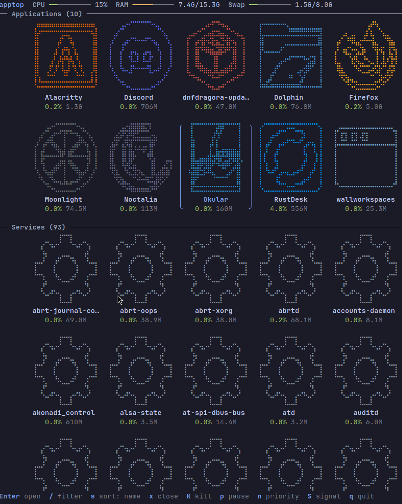
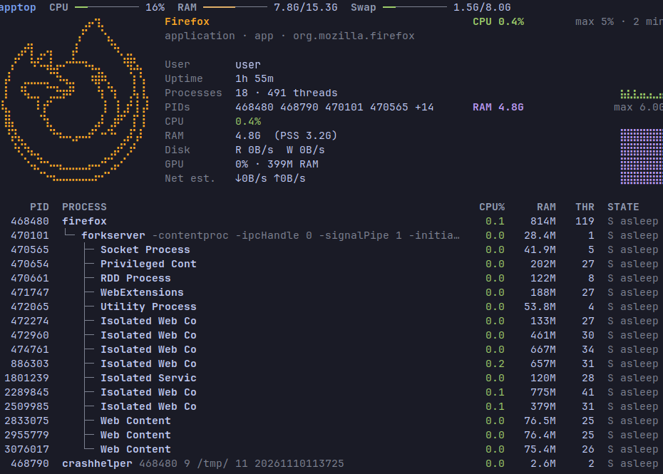
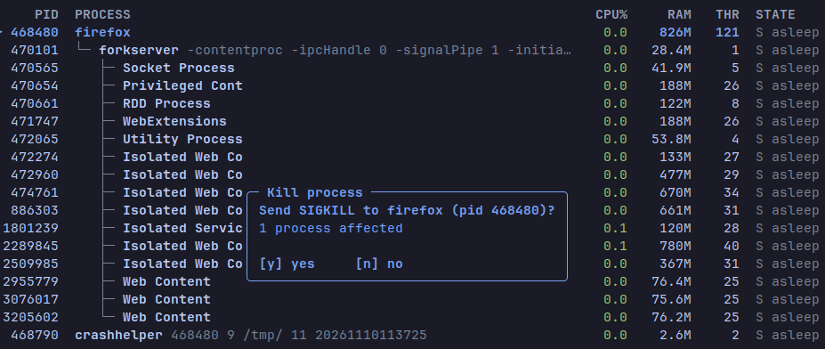

# apptop

**English** · [Español](README.es.md)

A resource monitor for the Linux terminal, in the spirit of btop but centred on
**applications** instead of individual processes.

- The main screen is a grid with the icon of every running app and service.
  Each icon is the app's real icon turned into a braille line outline (no fill,
  no background), drawn in its dominant colour.
- Opening an icon shows that app in detail: all its processes as a tree, CPU,
  RAM, disk, GPU and network, with graphs of the last two minutes.
- From there (or from the grid) you can close, kill or pause it, change its
  priority or send any signal, to the whole app or to a single process.

It does not need root: whatever cannot be read is shown as `n/a`.

## Screenshots

The grid. Apps with an icon draw it in its colour; the rest get a generic
window, and services a gear:



Inside an app: its details, CPU and RAM graphs, and its process tree:



The detail view as text (80×24), from the snapshot tests:

```text
apptop  CPU n/a  RAM n/a  Swap n/a                    ⟳ 1s · 3 apps · 2 services
                          Firefox                           CPU 23.5%   max 100%
⢀⠔⠒⠒⠒⠒⠒⠒⠒⠒⠒⠒⠒⠒⠒⠒⠒⠒⠒⠒⠒⠒⠢⡀  application · app                            ⢸⣿⡇
⢸ ⢰⡋⢙⡆⢸⠉⢹ ⣞⠉⣳          ⡇                                               ⢸⣿⡇
⢸⣀⣀⣉⣉⣀⣈⣉⣉⣀⣈⣉⣁⣀⣀⣀⣀⣀⣀⣀⣀⣀⣀⡇  User       ana                               ⢸⣿⡇     ⣀
⢸                      ⡇  Uptime     2h 03m                            ⢸⣿⣇⣤⣴⣶⣾⣿⣿
⢸                      ⡇  Processes  3 · 172 threads             ⣀⣀⣠⣤⣶⣾⣿⣿⣿⣿⣿⣿⣿⣿⣿
⢸                      ⡇  PIDs       4100 4130 4222         RAM 5.3G    max 6.6G
⢸                      ⡇  CPU        23.5%
⢸                      ⡇  RAM        5.3G  (PSS 1.2G)              ⢀⣀⣀⣀⣤⣤⣤⣤⣶⣶⣶⣾⣿
⢸                      ⡇  Disk       R 2.3M/s  W 342K/s          ⣿⣿⣿⣿⣿⣿⣿⣿⣿⣿⣿⣿⣿⣿⣿
⠈⠢⠤⠤⠤⠤⠤⠤⠤⠤⠤⠤⠤⠤⠤⠤⠤⠤⠤⠤⠤⠤⠔⠁  GPU        18% gfx · VRAM 512M         ⣿⣿⣿⣿⣿⣿⣿⣿⣿⣿⣿⣿⣿⣿⣿
                          Net est.   ↓820K/s ↑50.8K/s            ⣿⣿⣿⣿⣿⣿⣿⣿⣿⣿⣿⣿⣿⣿⣿

     PID  PROCESS                                  CPU%     RAM   THR  STATE
    4100  firefox                                   1.5    900M   120  S asleep
    4130  ├─ firefox -contentproc -isForBrowser…    1.5    400M    30  S asleep
    4222  └─ firefox                               97.2    250M    22  T stopped


x close  K kill  p pause  n priority  S signal  Esc back  q quit
```

Every destructive action asks for confirmation and says what it affects and
how many processes:



A real icon converted (`apptop --dump-icon firefox --large`) and the two
generic icons:

```text
             ⢀⡤⢲⡀
            ⢠⠋  ⠑⣄
   ⣠⠞⡇⢀⡠⡄  ⢠⠇    ⠈⠳⡀⣀
  ⡜⠁ ⠳⠫⢤⣇⡤⠔⠚⠒⠲⢤⣀   ⠘⢿⣣⡀
 ⡼  ⣀⣀⣀⣀⠉⠳⢤⣀  ⠰⣾⠷⡀  ⠈⡆⢣
 ⡇ ⠘⢧⣀⡀⠈⣉⣓⡶⠟   ⠘⡆⠙⡆ ⢀⢧⢸⡀
⠸⣄    ⠇⡞⠁       ⢸ ⢸⢀⡞⢸⢠⠇
 ⣿⡄   ⠈⢳⡀      ⣠⠇⢀⡾⠋ ⡏⢸
 ⠘⡽⣄    ⠙⠲⠤⢄⡤⠤⠞⠁⠒⠙⠂⢀⡼⢡⠇
  ⠘⢎⠳⣄⡀          ⢀⡴⠋⡰⠃
    ⠑⢤⡙⠒⠤⢤⣀⣀⣀⣀⡤⠤⠚⢉⡤⠊
      ⠈⠑⠲⠤⠤⠤⠤⠤⠤⠖⠊⠁
```

```text
      ⢰⠒⠒⡆         ⢀⣀⣀⣀⣀⣀⣀⣀⣀⣀⣀⣀⣀⡀
  ⡔⠉⠲⠔⠊  ⠑⠢⠖⠉⢢    ⢸⠁⡖⡆⢰⢲⢀⡖⡆     ⠈⡇
  ⢘⠆  ⣀⠤⠤⣀  ⠰⡃    ⢸⠤⠭⠥⠬⠭⠤⠭⠥⠤⠤⠤⠤⠤⠤⡇
⢰⠒⠊  ⡜⠁  ⠈⢣  ⠑⠒⡆  ⢸              ⡇
⠸⠤⢄  ⢣⡀  ⢀⡜  ⡠⠤⠇  ⢸              ⡇
  ⢨⠆  ⠉⠒⠒⠉  ⠰⡅    ⢸              ⡇
  ⠣⣀⠴⠢⢄  ⡠⠔⠦⣀⠜    ⢸⡀            ⢀⡇
      ⠸⠤⠤⠇         ⠈⠉⠉⠉⠉⠉⠉⠉⠉⠉⠉⠉⠉⠁
```

In a terminal the outlines are coloured; here they are plain text.

## Installation

Requires x86-64 Linux with cgroup v2 and systemd. After any of these, run it
by typing `apptop`.

### Package (Debian, Ubuntu, Fedora, openSUSE…)

Download the package for your distribution from the
[latest release](https://github.com/workharleyhsu/apptop/releases/latest) and open it with your software centre,
or install it from a terminal:

```sh
sudo apt install ./apptop_0.1.3-1_amd64.deb      # Debian, Ubuntu, Mint…
sudo dnf install ./apptop-0.1.3-1.x86_64.rpm     # Fedora, RHEL…
sudo zypper install ./apptop-0.1.3-1.x86_64.rpm  # openSUSE
```

Uninstall with `sudo apt remove apptop` or `sudo dnf remove apptop`.

### One-line installer (any distribution)

```sh
curl -fsSL https://raw.githubusercontent.com/workharleyhsu/apptop/main/install.sh | sh
```

It downloads the latest release, verifies its SHA-256 checksum and installs
the binary to `~/.local/bin`. It does not need root. If that folder is not in
your `PATH`, the script tells you the line to add. Uninstall with
`rm ~/.local/bin/apptop`.

### Manual

Every option uses the same static executable, so it does not depend on your
distribution's version. You can also unpack it yourself:

```sh
tar -xzf apptop-0.1.3-x86_64-linux.tar.gz
sha256sum -c apptop-0.1.3-x86_64-linux.tar.gz.sha256   # optional
install -Dm755 apptop-0.1.3-x86_64-linux/apptop ~/.local/bin/apptop
```

### From source

With stable Rust (2021 edition):

```sh
git clone https://github.com/workharleyhsu/apptop
cd apptop
cargo install --path .        # installs to ~/.cargo/bin/apptop
```

Do not run apptop with `sudo`: it is not needed, and as root the actions would
reach every process on the system.

The icons need a font with braille glyphs and look best in a terminal with
24-bit colour (otherwise they fall back to 256 colours). The minimum size is
80×24.

## Keys

### Grid

| Key | Action |
|-----|--------|
| `←` `↑` `↓` `→` / `h` `j` `k` `l` | Move the selection |
| `Home` / `g`, `End` / `G`, `PgUp`, `PgDn` | Jump |
| `Enter` | Open the app's detail view |
| `/` | Filter by text (name, id or the name of any of its processes) |
| `s` | Cycle the sort order: name → CPU → RAM |
| `Tab` | Show all → apps only → services only |
| `Esc` | Clear the filter |
| `q` / `Ctrl+C` | Quit |

Mouse: a click selects, a click on the already selected app opens it, and the
wheel moves by one row.

### Detail view

| Key | Action |
|-----|--------|
| `↑` `↓` / `j` `k` | Choose a process in the tree (above the first one: the whole app) |
| `Esc` / `Backspace` | Back to the grid, with the same selection |
| `q` | Quit |

### Actions (in the grid and in the detail view)

They act on the selected app. In the detail view, if a process is chosen in
the tree, they act on that process only.

| Key | Action |
|-----|--------|
| `x` | Close (SIGTERM), with confirmation |
| `K` | Kill (SIGKILL), with confirmation |
| `p` | Pause / resume (SIGSTOP / SIGCONT) |
| `n` | Change the priority (nice) |
| `S` | Menu to pick any signal |
| `+` / `-` | Refresh faster / slower |

In dialogs only `y` confirms (`s` also works); any other key cancels.

apptop never signals itself, and it will not pause the shell or the terminal
it runs in.

**About priority.** It only matters when the CPU is saturated: it decides who
gets CPU time when there is not enough for everyone. Raising a process's
priority (lowering its nice value) requires privileges, and apptop tells you
which permission is missing. That also means lowering priority is one-way for a
regular user: to get it back you have to restart the app.

## Command line

```text
apptop                        interactive interface
apptop -r 2                   refresh every 2 seconds (0.25 to 10)
apptop --lang es              Spanish interface
apptop --list                 detected apps, PIDs and usage, as plain text
apptop --dump-icon firefox    converted icon (--large for the big size)
apptop --snapshot             one frame of the grid, as text
apptop --snapshot --app firefox --size 120x40
                              one frame of an app's detail view
apptop --explain steam        why the matching processes were grouped that way
apptop --print-config         effective configuration
apptop --config other.toml    use another configuration file
```

`--list`, `--dump-icon` and `--snapshot` do not need a terminal: they are meant
for scripts and for checking what apptop detects.

If an app shows up in the wrong section or under the wrong name, please attach
the output of `apptop --explain <name>` to the bug report.

## Configuration

Optional, in `~/.config/apptop/config.toml`:

```toml
refresh = 1.0          # seconds between refreshes (0.25 to 10)
sort = "name"          # name | cpu | ram
icon_size = "large"    # small (8x4) | medium (12x6) | large (16x8)
language = "en"        # en | es

[theme]
color = "auto"         # auto | truecolor | 256
accent = "#7aa2f7"     # colour of the selection and the shortcuts
icons = "breeze"       # icon theme; defaults to the desktop's
```

An invalid value or an unknown key produces a warning and the default is used;
they never prevent apptop from starting.

The interface is in English by default and also available in Spanish.

## How it works

**Grouping processes into apps.** Each process's cgroup
(`/proc/<pid>/cgroup`) decides: `app-*.scope` units are graphical apps
(`app-flatpak-*` ones are Flatpaks), and so are the `app-<id>@<instance>.service`
units KDE Plasma uses to launch apps. Other `*.service` units are user or
system services; an `app-<id>@autostart.service` counts as an app only if its
`.desktop` entry is visible in the menu (so Steam started at login is an app,
a tray agent is a service). Container scopes are shown as services. Several windows of the
same app are merged into one. If a program with its own `.desktop` file was
started from another app (a browser launched from a terminal), it is split out
as its own app. Whatever has no useful cgroup is grouped by executable and
parent tree.

**Name and icon.** They come from the `.desktop` file, looked up by unit name,
`StartupWMClass`, the `Exec` program or the executable's name. The icon is located in the active theme, falling
back to hicolor and pixmaps.

**Icons.** The SVG or PNG is rasterised and cropped to its content; the
silhouette (alpha channel) and the inner colour edges (Sobel with non-maximum
suppression and hysteresis) are detected, and the result is mapped to braille
at 2×4 dots per cell. The colour is the dominant hue, ignoring transparent,
white, black and grey pixels. Converted icons are cached in `~/.cache/apptop/`
and invalidated when the file's path, date or size changes.

**Data.** Everything comes from `/proc` and `/sys`; no other programs are run.

**CPU.** Every percentage is relative to the whole machine, like the top bar:
100 % means every core is busy. On a 12-core machine an app that saturates one
core shows as 8 %, not 100 %.

## Limitations

- **Network is estimated** (and labelled as such in the interface). Without
  root the kernel has no per-process counters; apptop matches the app's sockets
  against the TCP counters from `sock_diag`. It only counts TCP (not UDP or
  QUIC) and misses connections that open and close between two refreshes.
- **Other users' processes:** disk, GPU, network and PSS can only be read for
  your own processes; the rest show `n/a (no permission)`.
- **GPU:** read from `fdinfo` (`drm-engine-*`, `drm-memory-*`). Verified on
  real hardware with Intel (i915); the AMD (amdgpu) format is covered by tests
  with sample data, not tried on a real machine.
- **Icons:** SVG and PNG are supported. Text inside an SVG is not drawn.
- **Reparented helpers:** a helper process with a different executable that was
  orphaned (a `crashhelper`, for instance) can show up under the app the
  program was launched from.
- **New installs:** the `.desktop` index is loaded at startup, so an app
  installed while apptop is open gets its name and icon after a restart.

## Development

```sh
cargo fmt
cargo clippy --all-targets -- -D warnings
cargo test
cargo build --release
```

Interface tests use `ratatui::backend::TestBackend` with `insta` snapshots
(`INSTA_UPDATE=always cargo test` regenerates them). The action tests only
send signals to `sleep` processes they start themselves.

User-facing text lives in `src/i18n.rs`; adding a string means adding it in
both languages, and the compiler enforces it.

`scripts/package.sh` builds everything a release ships (static tarball, `.deb`,
`.rpm` and checksums) into `dist/`. It needs
`rustup target add x86_64-unknown-linux-musl` and
`cargo install cargo-deb cargo-generate-rpm`.

Code comments, `NOTES.md` (design decisions and performance measurements) and
`PROGRESS.md` are in Spanish.

## License

Dual-licensed, at your option, under [MIT](LICENSE-MIT) or
[Apache-2.0](LICENSE-APACHE).

Unless you explicitly state otherwise, any contribution intentionally
submitted for inclusion in this project shall be dual-licensed as above,
without any additional terms or conditions.
